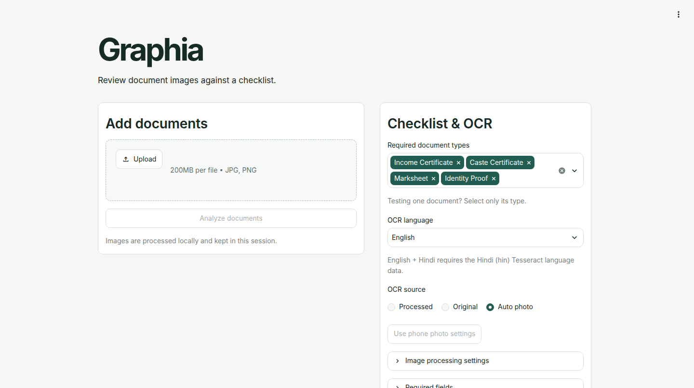

# Graphia

**Document Intelligence for Application Readiness and Missing-Requirement Detection**

Project 042 · Digital Image Processing · Academic group project by **Sakshi Gupta** and **Jigisha Baiswar**

Graphia helps students review scholarship application documents before submission. Upload document images to see which required documents were detected, which fields were extracted, and what still needs attention.

**[Launch Graphia on Streamlit](https://9vqvn98mcqbgmps2tuhfwc.streamlit.app/)** · [Try it with fictional documents](#try-the-demo)



*Graphia dashboard captured from the current local app.*

## Project team

| Team member | Contributions |
| --- | --- |
| **Sakshi Gupta** | Built the image preprocessing and Tesseract OCR modules, prepared the fictional dataset and reference transcripts, and ran the preprocessing and OCR comparison experiments. Led integration and prepared the academic report and DIP viva notes. |
| **Jigisha Baiswar** | Built rule-based document classification, field extraction, checklist scoring, and the Streamlit interface with downloadable reports. Validated the application in a browser and prepared the presentation, diagrams, and demo materials. |

## How it works

1. Upload one or more JPG, JPEG, or PNG files. Graphia recognizes supported layouts for income certificates, caste certificates, marksheets, and identity proofs.
2. Review the image processing stages. The app exposes grayscale conversion, denoising, contrast enhancement, thresholding, and morphology so you can see how each stage affects the text.
3. Compare Tesseract OCR output from the original and processed images. **Auto photo** can also try cropping and rotation on photographed documents.
4. Review the detected type, extracted fields, and checklist results. Export the report as JSON or Markdown.

## What the checklist measures

**Coverage** counts required document types detected. **Readiness** counts required types with at least one readable submission containing all configured fields. Both scores use the total number of required types as the denominator. Duplicate submissions count once per type.

| Example with four required types | Coverage | Readiness |
| --- | ---: | ---: |
| All four types detected and usable | 100% | 100% |
| All four types detected, one missing a required field | 100% | 75% |
| Three types detected, all three usable | 75% | 75% |

The bundled checklist looks for an income amount, a caste category, a student name on the marksheet, and a PAN number on the identity proof. You can inspect the rules in [`config/document_checklist.json`](config/document_checklist.json). Graphia checks application completeness and readability. Authenticity and official scholarship eligibility are outside its scope.

## Try the demo

1. Open the [Streamlit app](https://9vqvn98mcqbgmps2tuhfwc.streamlit.app/) and download a clear fictional sample from the [sample dataset](dataset/README.md).
2. Upload the image and select **Analyze documents**. Review the detected type, image stages, and OCR output.
3. Add or remove a document and analyze again to see how coverage and readiness change. Some older fictional samples lack fields in the current checklist and may appear as detected but unusable.
4. Download a JSON or Markdown report. Use fictional documents for the hosted demo and for shared screenshots or reports.

## Run locally on Ubuntu

```bash
sudo apt update
sudo apt install git python3 python3-venv python3-pip tesseract-ocr tesseract-ocr-eng

git clone https://github.com/guptasakshi06/Graphia.git
cd Graphia
python3 -m venv .venv
source .venv/bin/activate
python -m pip install -r requirements.txt
python scripts/check_environment.py
python -m streamlit run app.py --server.address=127.0.0.1
```

Open the local URL printed by Streamlit. For supported bilingual forms, install `tesseract-ocr-hin` and select **English + Hindi** in the app.

## Repository layout

| Path | Contents |
| --- | --- |
| [app.py](app.py) | Streamlit upload, analysis, and reporting interface |
| [modules/](modules/) | OpenCV and NumPy preprocessing, Pytesseract OCR, classification, field extraction, and readiness logic |
| [config/](config/) | Checklist and readability settings |
| [dataset/](dataset/) | Eight fictional images and reference transcripts |
| [scripts/](scripts/) and [tests/](tests/) | Environment checks, OCR evaluation, and automated tests |
| [docs/](docs/) and [outputs/](outputs/) | Academic materials, experiment results, screenshots, and sample reports |

## Evaluation and project materials

In the eight-image fictional dataset, original-image OCR and the preprocessing pipeline selected as the default for that experiment both had a pooled character error rate of 0%. Some alternative settings damaged text, including a global threshold that blanked the faint income certificate. The experiment covered four generated layouts and their degraded variants. [Experiment summary](outputs/experiments/SG05/summary.csv)

Run the automated tests from the activated virtual environment.

```bash
python -m unittest discover -s tests -v
```

- [Architecture diagram](docs/diagrams/architecture.png) and [workflow diagram](docs/diagrams/workflow.png)
- [Academic report](docs/project_report.pdf) and [presentation](docs/project_042_presentation.pptx)
- [Browser validation and evidence](docs/merge/M02.md) and [delivery manifest](docs/DELIVERY.md)
