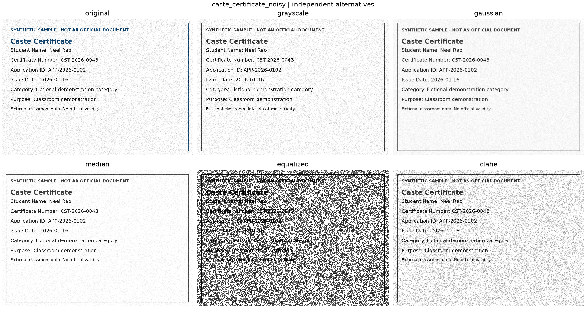
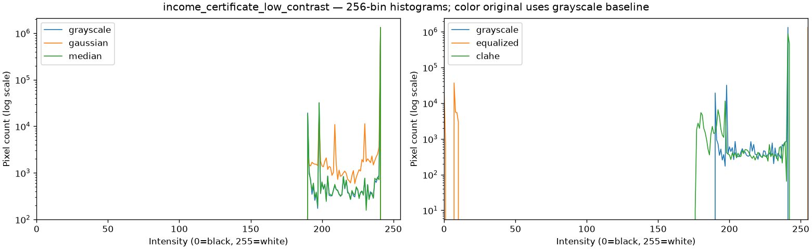
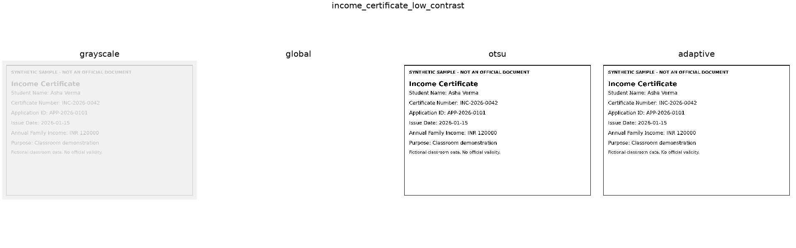
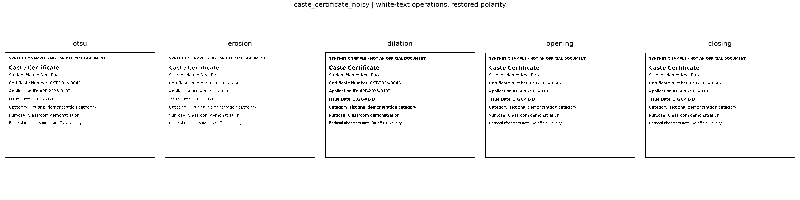
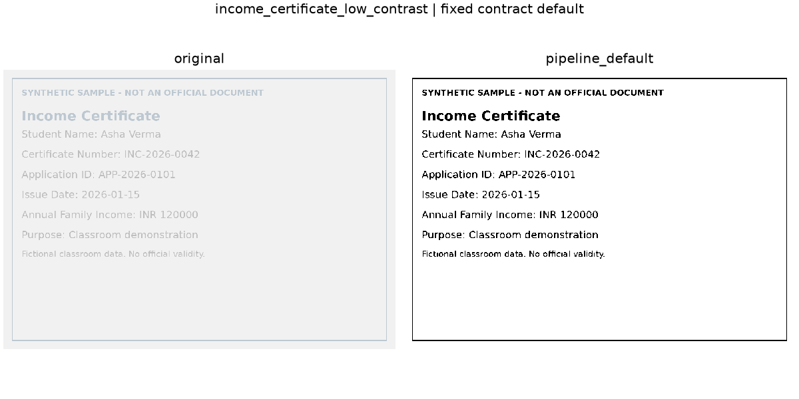
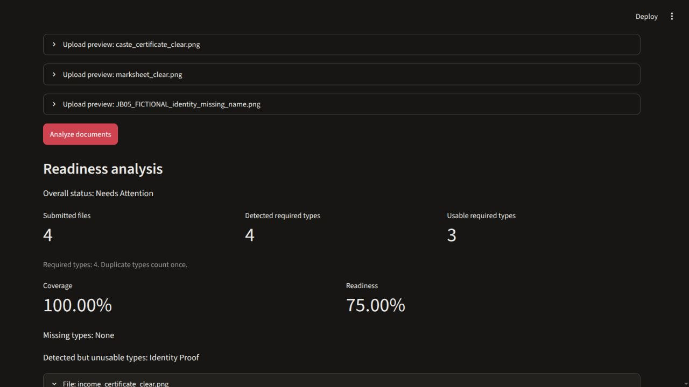

# Document Intelligence for Application Readiness and Missing-Requirement Detection

**Project 042 | Digital Image Processing**

**College project report**

**Sakshi Gupta** — Roll number: [Sakshi’s roll number]

**Jigisha Baiswar** — Roll number: [Jigisha’s roll number]

College: [College name]

Department: [Department name]

Faculty guide: [Faculty guide name]

Cover format: [Apply the college’s prescribed cover format if required]

<!-- pagebreak -->

## Abstract

This project uses digital image processing and optical character recognition (OCR) to check whether a set of scholarship document images meets a demonstration checklist. A local Streamlit application displays intermediate images, runs Tesseract on the original and processed versions, and applies rules to the selected text. The report separates a missing document type from a detected type whose required information could not be recovered.

The evaluation used eight fictional images derived from four distinct layouts. Original OCR and the fixed default pipeline each produced zero normalized character edits across 2,190 reference characters. Both gave 8/8 correct types and 28/28 exact present fields. Preprocessing did not improve these results; several alternatives made them worse. In a separate browser scenario, all four types were detected but only three were usable, giving 100% coverage and 75% readiness. The system checks configured requirements and does not verify authenticity or scholarship eligibility.

## Introduction

Applicants may have the right files but still miss a required item, such as a student name that is faint or absent. Conversely, a filename can suggest a document type even when its contents cannot be read. We use image processing to make these failures observable, then use OCR text and explicit rules to decide which checklist items have usable information.

## Problem Statement

Given a set of JPG, JPEG or PNG images, determine which required document types are detected and which have at least one readable candidate with the required fields. Preserve the original image and the OCR output so a user can inspect why a type or field was missed.

## Objectives

- Compare seven groups of digital image processing and OCR outputs under fixed settings.
- Recognize four document categories and extract supported labeled fields conservatively.
- Distinguish missing types from detected but unusable types and export an explanation.
- Measure OCR errors, type recognition, field extraction and checklist outcomes separately.

## Existing Approach

A manual review can check both presence and legibility but must be repeated for each submission. A filename checklist is quicker but cannot inspect content. Raw OCR provides a useful baseline and can be sufficient on clean images; it leaves classification and completeness decisions to the reviewer. Our approach combines inspectable image stages, a raw OCR baseline and a configurable checklist. These alternatives frame the design; manual review time was not measured.

<!-- pagebreak -->

## Proposed Methodology

Decode each upload and retain its original pixels. Show grayscale, denoised, enhanced, thresholded and morphology stages. Run OCR independently on the original and the configured processed image. The user selects which text feeds classification and extraction. Match title cues to identify Income Certificate, Caste Certificate, Marksheet or Identity Proof; return Unknown when evidence is absent or ambiguous. Extract labeled fields with conservative patterns and retain missing values as null.

## System Architecture

Streamlit coordinates the local workflow. [8] Pillow decodes the upload, NumPy stores the arrays, and OpenCV performs the image operations. Pytesseract calls the local Tesseract engine. Python rules classify the selected OCR text and extract fields; the readiness module combines those records with the selected JSON checklist and produces Markdown and JSON downloads. Matplotlib generates the experimental comparisons separately from the upload flow.

> Architecture diagram pending M03 insertion: `diagrams/architecture.png`

> Workflow diagram pending M03 insertion: `diagrams/workflow.png`

## Implementation

| Component | Responsibility |
|---|---|
| `app.py` | Accepts upload bytes, shows images and both OCR texts, manages choices and downloads. Input changes clear stale results. |
| `modules/preprocessing.py` | Applies EXIF orientation, composites transparency on white and caps the longest side at 1,800 pixels while preserving aspect ratio. Returns BGR or grayscale stages and resolved settings. |
| `modules/ocr.py` | Calls Tesseract with English, page segmentation mode 6 and a 20-second timeout. Distinguishes text, no text and errors. |
| `modules/classification.py` and `modules/extraction.py` | Match title cues and nearby labels. Extract student name, certificate number, application ID and issue date where supported. |
| `modules/readiness.py` and `config/requirements.json` | Validate the checklist and count unique detected and usable required types. Keep a record for every upload. |

The baseline checklist requires names on all four types and certificate numbers on the two certificates. An OCR result is considered readable when its status is successful and it contains at least 20 alphanumeric characters. A type is usable only when one readable candidate has all its required fields; candidates cannot pool fields. Coverage is 100 × detected required types ÷ required types. Readiness uses usable required types as its numerator. Missing types yield **Incomplete**; otherwise, any unusable type yields **Needs Attention**. All required types usable yields **Ready**. An empty checklist is rejected.

<!-- pagebreak -->

## Digital Image Processing Techniques

### Image representation and grayscale

An image is a grid of pixels. We use unsigned 8-bit channels (values 0 to 255) and store color images in OpenCV’s blue, green, red order. Grayscale keeps one weighted intensity: Y ≈ 0.299R + 0.587G + 0.114B. For (R, G, B) = (100, 150, 200), Y rounds to 141. It simplifies intensity operations; it can also remove useful color contrast. [1]

### Denoising and contrast

A Gaussian filter averages neighboring intensities with more weight near the center. It smooths small fluctuations but can soften thin strokes. A median filter replaces the center with the middle ranked value. For the window values 20, 21, 22, 23, 24, 25, 26, 27 and 255, the median is 24; the isolated bright outlier has little influence. Both filters were compared at 3 × 3. [2]

A grayscale histogram counts pixels at each intensity. Global equalization remaps intensities using the cumulative histogram of the entire image; it can stretch noise as well as text contrast. CLAHE estimates a mapping in each tile, clips tall histogram bins to limit amplification, and interpolates across tiles. We used an 8 × 8 tile grid with clip limit 2.0. [3]

### Thresholding and morphology

Thresholding separates darker text from a brighter page. The global demonstration uses 127 everywhere: values at or below 127 become black, and higher values become white. Otsu also uses one cutoff but picks it from the histogram by minimizing within-class variance, equivalently maximizing between-class variance. Adaptive Gaussian thresholding uses the weighted local average minus C; the experiment used a 31 × 31 neighborhood and C = 11. It can address uneven lighting but may preserve speckle. [4]

Morphology changes shape using a structuring element. With white foreground, erosion shrinks strokes and dilation expands them. Opening is erosion followed by dilation, useful for removing small specks; closing reverses the order and can bridge small gaps. We invert dark text to white before applying a 2 × 2 rectangular element, then restore dark text. Larger or poorly placed elements can erase strokes or join nearby letters. [5]

### OCR and the selected pipeline

The fixed default runs grayscale, median filtering, CLAHE and Otsu, with morphology disabled. It supplies the processed image for the default OCR source. Tesseract converts pixels into text; PSM 6 treats the page as a single uniform block of text. Tesseract can also preprocess internally, so the original-image path is an important comparison. The project uses the existing engine and language data without training a model. [6, 7]

<!-- pagebreak -->

## Experimental Results

### Dataset and measurement protocol

The eight fictional 1,400 × 1,000 PNGs comprise four clear layouts, one low-contrast derivative, one Gaussian-noise derivative and two slightly blurred derivatives. None required resizing. SG05 ran eight samples through 14 fixed methods (112 real OCR calls) and then made 16 separate calls through the real upload path. An independent repeat produced 282 byte-identical saved files. M02 audited the preserved outputs without running new OCR. [9]

Filtering, contrast and threshold alternatives start independently from grayscale. Each morphology alternative starts from grayscale Otsu. The original and full pipeline are separate OCR inputs. The engine was Tesseract 5.3.4 with Pytesseract 0.3.13; language, PSM and timeout match the application. Character error rate (CER) is the minimum number of insertions, deletions and substitutions divided by reference length. Text was casefolded and whitespace collapsed and trimmed; punctuation was kept. Pooled CER divides total edits by 2,190 characters. Field matches use exact case-sensitive strings.

**Table 1. Frozen OCR, type and field results.** CER values are displayed to nine decimal places when nonzero.

| Method | Edits | Pooled CER | Types correct | Present fields exact |
|---|---:|---:|---:|---:|
| Original | 0 | 0 | 8/8 | 28/28 |
| Grayscale | 0 | 0 | 8/8 | 28/28 |
| Gaussian | 0 | 0 | 8/8 | 28/28 |
| Median | 0 | 0 | 8/8 | 28/28 |
| Global equalization | 2442 | 1.115068493 | 7/8 | 23/28 |
| CLAHE | 0 | 0 | 8/8 | 28/28 |
| Global threshold | 290 | 0.132420091 | 7/8 | 24/28 |
| Otsu | 0 | 0 | 8/8 | 28/28 |
| Adaptive threshold | 333 | 0.152054795 | 7/8 | 24/28 |
| Erosion | 1 | 0.000456621 | 8/8 | 27/28 |
| Dilation | 0 | 0 | 8/8 | 28/28 |
| Opening | 0 | 0 | 8/8 | 28/28 |
| Closing | 0 | 0 | 8/8 | 28/28 |
| Fixed default pipeline | 0 | 0 | 8/8 | 28/28 |

All methods correctly preserved four absent certificate-number slots, scored separately. Seven of the 112 rows had nonzero CER; five had a type or field mismatch. Three type outcomes were Unknown. There was one no-text outcome and no engine or setup error. CER can exceed 1 if OCR inserts many extra characters.

<!-- pagebreak -->

### Intensity filtering and threshold comparisons

**Figure 1.** Noisy caste sample: original versus grayscale; Gaussian versus median; original versus contrast enhancement. Global equalization amplified the background noise. OCR made 2,436 edits against 295 reference characters (CER 8.257627119), and the type became Unknown.

**Figure 2.** Faint income sample: intensity distributions before and after the two contrast operations. A wider histogram alone does not establish better OCR.

**Figure 3.** Faint income sample: global thresholding turned the page white (no text; 288/288 edits). Otsu and adaptive thresholding did not erase it. On the noisy caste image, adaptive thresholding instead produced 333/295 edits and an Unknown type. [9]

<!-- pagebreak -->

### Morphology and the original OCR baseline

**Figure 4.** Noisy caste sample: erosion versus dilation and opening versus closing. Erosion changed “Application ID” to “Application 1D,” losing an optional field even though the normalized OCR changed by only one character (1/295). The checklist could still treat the type as usable.

**Figure 5.** Faint income sample: original and fixed processed OCR inputs. Both returned the reference text after normalization. The same tie held across all eight pairs, so these data give no measured improvement from preprocessing. [9]

The blurred identity sample lost the optional issue date after global equalization (5/244 edits). Equalization of the blurred marksheet and global thresholding of the blurred identity sample also changed some non-field text while preserving type and fields. The differences show why we report field matches separately from CER and why manual selection of original OCR is useful.

<!-- pagebreak -->

### Readiness in the integrated application

The eight-image upload run gave eight submitted files, four unique required types detected, four usable, 100% coverage and 100% readiness. The four-image clear subset and the four-image degraded subset each had four usable types. The browser results below are separate executions against the real app, not fixture tests. [9]

**Table 2. Frozen browser download results.** Detected and usable counts refer to unique required types.

| Browser scenario | Files | Detected | Usable | Required | Coverage | Readiness | Status |
|---|---:|---:|---:|---:|---:|---:|---|
| Single | 1 | 1 | 1 | 4 | 25% | 25% | Incomplete |
| Complete | 4 | 4 | 4 | 4 | 100% | 100% | Ready |
| Missing | 3 | 3 | 3 | 4 | 75% | 75% | Incomplete |
| Unusable | 4 | 4 | 3 | 4 | 100% | 75% | Needs Attention |
| Edge batch | 9 | 4 | 3 | 4 | 100% | 75% | Needs Attention |
| Checklist subset | 9 | 3 | 3 | 3 | 100% | 100% | Ready |
| Original source | 9 | 3 | 3 | 3 | 100% | 100% | Ready |
| Changed settings | 9 | 3 | 3 | 3 | 100% | 100% | Ready |

**Figure 6.** Original JB05 browser capture for the unusable scenario. Identity Proof was recognized and its OCR met the readability heuristic; its required student name was missing. The nine-file edge batch also retained a blank image, an unrelated image, a corrupt input and two identical income uploads with distinct IDs. Duplicate uploads did not increase either percentage. [9]

<!-- pagebreak -->

## Limitations

The study uses four generated layouts with large print and straightforward labels; the four degraded versions are related to the clear originals. There is no independent holdout and no study of real scans, handwriting, rotated pages or multiple languages. Case and line-boundary errors can disappear during CER normalization. The character-count heuristic can accept incorrect OCR, and optional-field errors may not affect readiness.

The app checks the configured document types and recoverable information. It does not establish document authenticity, verify official eligibility, or check that the uploads belong to the same applicant. The fictional samples intentionally use different names across types.

## Future Scope

Evaluate on independent, consented or openly reusable scans and report results by capture condition and layout. Assess whether deskew and better lighting correction help under fixed settings. Compare alternative preprocessing using a held-out set before changing defaults. PDF ingestion, more languages and broader label support are potential extensions.

## Conclusion

The application demonstrates how changes to pixels affect OCR and how recognition errors can propagate to document and field decisions. The original and default processed images tied on the eight fictional samples, while some alternatives removed text or increased errors. The checklist’s separate coverage and readiness counts exposed a problem that a presence-only check would miss: a detected document with insufficient required information.

## References

1. OpenCV. Color conversions. https://docs.opencv.org/4.x/de/d25/imgproc_color_conversions.html
2. OpenCV. Smoothing images. https://docs.opencv.org/4.x/d4/d13/tutorial_py_filtering.html
3. OpenCV. Histogram equalization. https://docs.opencv.org/4.x/d5/daf/tutorial_py_histogram_equalization.html
4. OpenCV. Image thresholding. https://docs.opencv.org/4.x/d7/d4d/tutorial_py_thresholding.html
5. OpenCV. Morphological transformations. https://docs.opencv.org/4.x/d9/d61/tutorial_py_morphological_ops.html
6. Tesseract documentation. Improving the quality of the output. https://tesseract-ocr.github.io/tessdoc/ImproveQuality.html
7. Tesseract documentation. Command line usage. https://tesseract-ocr.github.io/tessdoc/Command-Line-Usage.html
8. Streamlit documentation. File uploader. https://docs.streamlit.io/develop/api-reference/widgets/st.file_uploader
9. Project 042. [M02 evidence freeze](merge/M02.md), 10 November 2026. Primary records: [SG05 method summary](../outputs/experiments/SG05/summary.csv), [paired OCR results](../outputs/experiments/SG05/original_processed.csv), and [JB05 browser downloads](../outputs/reports/JB05/).

Official documentation consulted 10 November 2026.
